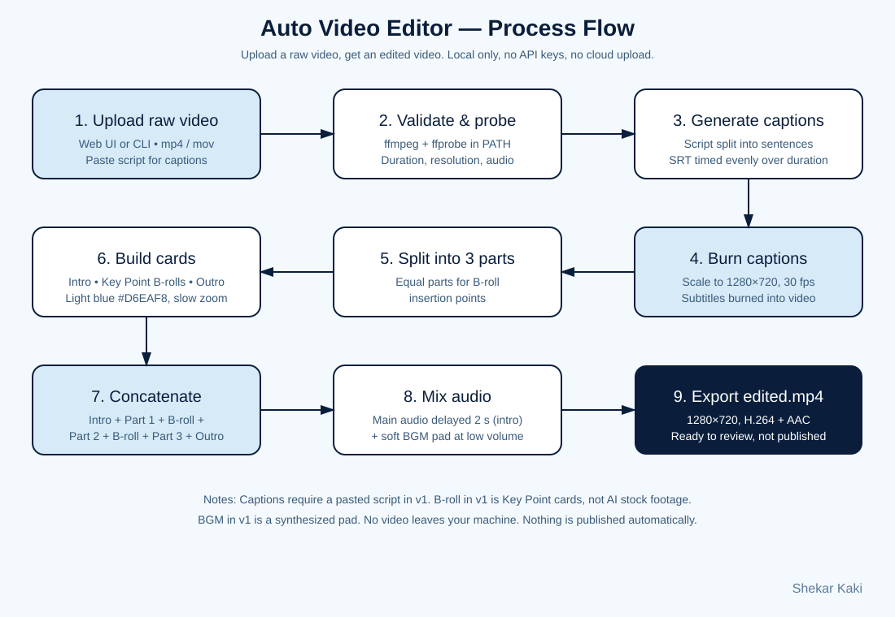
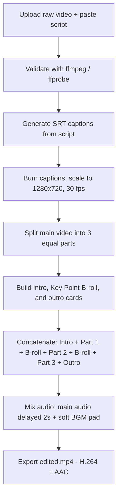

# Auto Video Editor

> Upload a raw video, get back an edited video — intro, captions, B-roll cards, outro, and background music. Local only. No API keys. No cloud upload. No paid plan required.

Inspired by the "upload raw video, AI does the rest" Short format. This project is a local, ffmpeg-based equivalent: it does the same job list (captions, B-roll, motion cards, music) on your own machine, without Claude Pro or any API key.

**Author:** Shekar Kaki — AI School 369
**Status:** v1.0.0 — working, tested end-to-end
**License:** MIT — see [LICENSE](LICENSE)

## Demo

Input: 30-second Milo stickman test video + its script.
Output: 38.1-second edited video, 1280×720, H.264 + AAC.

- Intro card (2 s) — AI School 369, light blue #D6EAF8
- Captioned main video, split into 3 parts
- Two Key Point B-roll cards (2 s each) between parts
- Outro card (2 s) — Thanks for watching, AI School 369
- Soft background music pad under the main audio

The test video itself is not committed to this repo (see `.gitignore`). Run the example below to reproduce it with your own raw video.

## Features

- [x] Intro and outro cards with signature
- [x] Captions burned in, timed from a pasted script
- [x] B-roll Key Point cards inserted between parts
- [x] Slow-zoom motion on cards
- [x] Background music pad, mixed at low volume with fade-out
- [x] Web UI and command-line interface
- [ ] Automatic speech-to-text (planned — needs Whisper; not bundled in v1)
- [ ] AI stock B-roll footage (planned — v1 uses Key Point cards)
- [ ] Licensed music library (planned — v1 uses a synthesized pad)

## Process flow



Full step-by-step flow, timing example, and limits: [docs/process-flow.md](docs/process-flow.md)



## Requirements

- Python 3.10+
- `ffmpeg` and `ffprobe` in your PATH
- Optional: Pillow for nicer cards (`pip install Pillow`). Without Pillow, ffmpeg colour + drawtext cards are used instead.

### macOS

```bash
brew install ffmpeg
pip3 install Pillow   # optional
```

### Ubuntu / Debian

```bash
sudo apt install ffmpeg python3-pip
pip3 install Pillow   # optional
```

## Quick start — Web UI (easiest)

```bash
git clone https://github.com/urbanschool369-oss/ai-school-369-auto-video-editor.git
cd ai-school-369-auto-video-editor
python3 app.py --web
```

Open http://localhost:8765 in your browser, upload a raw video, paste its script, click **Edit my video**.

The edited video is saved to `uploads/edited.mp4` in the project folder.

## Quick start — Command line

```bash
python3 app.py raw.mp4 --script examples/script.txt --out edited.mp4
```

With no script, a placeholder caption is used. For accurate captions, always paste or pass the real script.

## Project structure

```
.
├── app.py                  # Web UI + CLI + ffmpeg editing pipeline (stdlib only, Pillow optional)
├── README.md               # This file
├── LICENSE                 # MIT
├── CHANGELOG.md
├── CONTRIBUTING.md
├── .gitignore
├── docs/
│   ├── process-flow.md     # Step-by-step flow, timing, limits
│   └── process-flow.svg    # Process flow diagram
└── examples/
    └── script.txt          # Sample script used in the verified test
```

## Configuration

Edit the constants at the top of `app.py`:

| Constant | Default | Meaning |
| --- | --- | --- |
| `W`, `H`, `FPS` | 1280, 720, 30 | Output resolution and frame rate |
| `LIGHT_BLUE` | `D6EAF8` | Card background colour |
| Port (web mode) | 8765 | `python3 app.py --web --port 9000` to change |

## How captions work (v1, honestly)

Captions are generated from the script you provide, split into sentences and timed evenly across the video duration. This is deterministic and reliable, but it is not speech recognition. If the speaker pauses unevenly, caption timing will be approximate, not word-perfect.

To add true transcription later, install Whisper, transcribe the audio to `script.txt` first, then run this app unchanged. That pre-step is deliberately left out of v1 so the app stays dependency-light and honest about what it does.

## Privacy

- No video, script, or audio leaves your machine.
- No accounts, API keys, analytics, or telemetry.
- Nothing is published or uploaded automatically. Review `edited.mp4` before you share it anywhere.

## Contributing

See [CONTRIBUTING.md](CONTRIBUTING.md). Keep changes small, keep the stdlib-only core, and keep the honest-limits section in sync with what the code actually does.

## Changelog

See [CHANGELOG.md](CHANGELOG.md).

## Acknowledgements

- Built with ffmpeg — https://ffmpeg.org
- Inspired by the "upload raw video, AI does the rest" Short format. This project is an independent, local implementation, not affiliated with Claude, Google Vids, or the original Short creator.
