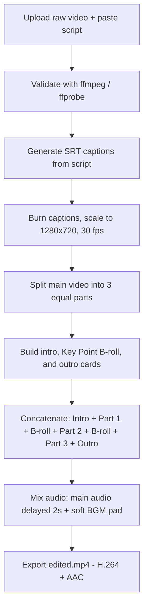

# Process Flow

## Flow in words

## Step-by-step

| Step | What happens | Tool | Output |
| --- | --- | --- | --- |
| 1. Upload | Raw video (mp4/mov) and script arrive via web UI or CLI | `app.py` web server / CLI | `uploads/input.mp4` |
| 2. Probe | Duration, streams and audio are checked | `ffprobe` | Duration in seconds |
| 3. Captions | Script is split into sentences and timed evenly across the video | `app.py` | `work/captions.srt` |
| 4. Burn-in | Video is scaled to 1280x720 at 30 fps and captions are burned in | `ffmpeg` + `subtitles` filter | `work/main_captioned.mp4` |
| 5. Split | Captioned video is split into 3 equal parts | `ffmpeg` | `work/part0.mp4`, `part1.mp4`, `part2.mp4` |
| 6. Cards | Intro, two Key Point B-roll cards and outro are rendered in light blue #D6EAF8 with a slow zoom | Pillow if available, otherwise `ffmpeg` colour + drawtext | `work/intro.mp4`, `broll0.mp4`, `broll1.mp4`, `outro.mp4` |
| 7. Concatenate | Segments are joined in order | `ffmpeg` concat demuxer | `work/video_only.mp4` |
| 8. Audio mix | Main audio is delayed 2 seconds (for the intro) and mixed with a soft BGM pad at low volume, with a fade-out | `ffmpeg` `amix` | Final audio track |
| 9. Export | Video and mixed audio are combined | `ffmpeg` | `edited.mp4` |

## Example timing

For a 30-second raw video:

- Intro: 0-2 s
- Part 1: 2-12 s
- B-roll 1: 12-14 s
- Part 2: 14-24 s
- B-roll 2: 24-26 s
- Part 3: 26-36 s
- Outro: 36-38 s
- Total: 38.1 seconds

## Honest limits (v1)

- Captions require a pasted script. There is no bundled speech-to-text in v1.
- B-roll in v1 is Key Point cards, not AI-generated stock footage.
- BGM in v1 is a synthesized pad, not a licensed song.
- SFX whoosh audio is generated into `work/`, but v1 mixes BGM + main audio cleanly to avoid sync drift.

Author: Shekar Kaki
